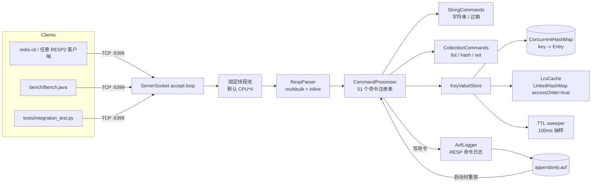

# mini-redis


一个用 **Java 17 从零实现**、**零第三方依赖** 的教学级 Redis 服务端。它真实监听 TCP 端口，使用 RESP2
协议与任意 Redis 客户端通信，支持字符串、列表、哈希、集合、TTL、LRU 淘汰、AOF 持久化和多线程并发访问。

项目目标不是复刻 Redis 的全部功能，而是把「一个 KV 服务端到底由哪些部件组成」讲清楚，并保证每一行代码
都能编译、启动、被测试覆盖。所有性能数字都来自本仓库 `bench/Bench.java` 的实测输出。

> 默认端口 **6399**（避免与本机 Redis 的 6379 冲突），默认单库（`SELECT 0`），默认最多 100000 个 key。

---

## 目录

- [特性](#特性)
- [架构](#架构)
- [快速开始](#快速开始)
- [配置](#配置)
- [命令清单（51 个）](#命令清单51-个)
- [设计要点](#设计要点)
- [测试](#测试)
- [实测性能](#实测性能)
- [目录结构](#目录结构)
- [已知限制](#已知限制)
- [License](#license)

---

## 特性

- **RESP2 协议**：支持 multibulk（`*N\r\n$len\r\n...`）和内联命令（`PING\r\n`、`ECHO "a b"\r\n`）两种请求格式；
  正确编码 `+OK`、`-ERR`、`:整数`、`$bulk`、`$-1`、`*数组` 回复。
- **51 个命令**：覆盖连接/通用、字符串、过期、列表、哈希、集合六组。
- **粘包 / 半包**：基于 `BufferedInputStream` 逐字节读取，一个 TCP 包里的多条命令、被拆成两段的一条命令都能正确处理。
- **TTL 双策略**：访问时惰性删除 + 后台每 100ms 抽样清扫，避免过期 key 长期占用内存。
- **LRU 淘汰**：可配置 `maxmemory`（按 key 数量），超过上限时淘汰最久未访问的 key；顺序结构独立加锁，不破坏
  `ConcurrentHashMap` 的并发安全。
- **AOF 持久化**：写命令以 RESP 数组追加到 `appendonly.aof`，启动时重放；支持 `always` / `everysec` / `no` 三种刷盘策略。
- **并发安全**：`ConcurrentHashMap` + 单 key `compute()` 保证 INCR、SET NX、EXPIRE、PUSH 等操作的原子性；
  网络层使用 `ServerSocket` + 固定大小线程池。
- **优雅关闭**：JVM shutdown hook 关闭监听、连接、线程池，并 flush + fsync AOF。
- **零依赖测试**：Java 测试不依赖 JUnit；另有完全独立的 Python 黑盒集成测试。
- **真实压测**：原始 socket 客户端，输出实测 QPS 与 P50 / P99 / P99.9 延迟。

---

## 架构



请求路径很短：`Socket → RespParser → CommandProcessor → KeyValueStore → RespWriter → Socket`。没有反射、
没有注解、没有框架，所有分发都是 `HashMap<String, Handler>` 的直接查表。

---

## 快速开始

环境要求：**JDK 17**（本项目在 `17.0.16` 上验证）。**不需要 Maven / Gradle / 任何第三方 jar。**

### 1. 编译

```bat
build.cmd
```

产物：`dist\miniredis.jar`（可执行 jar，Main-Class 已写入 manifest）。

### 2. 启动

```bat
run.cmd
```

看到下面的输出即启动成功：

```text
[miniredis] listening on 0.0.0.0:6399 (port=6399, maxmemory=100000, appendonly=true, aof=appendonly.aof, appendfsync=everysec, threads=128, sweepIntervalMs=100)
```

常用启动方式：

```bat
run.cmd --port=6400
run.cmd --port=6400 --appendonly=no
run.cmd --port=6400 --maxmemory=20000 --threads=8
run.cmd --port=6400 --aof=data\my.aof --appendfsync=always
```

### 3. 连接

如果本机装有 `redis-cli`：

```bat
redis-cli -p 6399
127.0.0.1:6399> SET hello world
OK
127.0.0.1:6399> GET hello
"world"
127.0.0.1:6399> LPUSH tasks a b c
(integer) 3
127.0.0.1:6399> LRANGE tasks 0 -1
1) "c"
2) "b"
3) "a"
```

没有 `redis-cli` 也可以用 Python 标准库直接发 RESP：

```python
import socket
s = socket.create_connection(("127.0.0.1", 6399))
s.sendall(b"*3\r\n$3\r\nSET\r\n$5\r\nhello\r\n$5\r\nworld\r\n")
print(s.recv(1024))   # b'+OK\r\n'
s.sendall(b"*2\r\n$3\r\nGET\r\n$5\r\nhello\r\n")
print(s.recv(1024))   # b'$5\r\nworld\r\n'
```

### 4. 跑测试

```bat
test.cmd                                              :: Java 测试（209 条断言）
python tests\integration_test.py                      :: Python 黑盒测试（116 条断言）
```

### 5. 压测

先启动服务端（建议关掉 AOF 看纯内存路径）：

```bat
run.cmd --appendonly=no
```

另开一个终端：

```bat
bench.cmd 127.0.0.1 6399 8 20000
```

参数含义：`host port 线程数 每线程 SET/GET 次数`。默认 `127.0.0.1 6399 8 20000`。

---

## 配置

优先级：**命令行 > `--config` 指定的文件 > 当前目录的 `miniredis.properties` > 内置默认值**。

命令行格式为 `--key=value` 或 `--key value`：

| 参数 | 默认值 | 说明 |
|---|---|---|
| `--port` | `6399` | 监听端口 |
| `--maxmemory` | `100000` | 最大 key 数量（不是字节数），超出后触发 LRU 淘汰 |
| `--appendonly` | `yes` | 是否开启 AOF（`yes/no`、`true/false`、`on/off`） |
| `--aof` | `appendonly.aof` | AOF 文件路径，相对路径基于启动目录 |
| `--appendfsync` | `everysec` | `always` / `everysec` / `no` |
| `--threads` | `CPU*4`（最少 4） | 网络工作线程数 |
| `--sweepIntervalMs` | `100` | 过期 key 后台清扫周期（毫秒，最小 10） |
| `--config` | 无 | 指定 properties 配置文件 |

`miniredis.properties` 示例（键名不区分大小写）：

```properties
port=6399
maxmemory=100000
appendonly=yes
aof=appendonly.aof
appendfsync=everysec
threads=128
sweepIntervalMs=100
```

也可以参考 `miniredis.properties.example`（该文件不会被自动加载）。

---

## 命令清单（51 个）

### 连接 / 通用（12）

| 命令 | 说明 |
|---|---|
| `PING [message]` | 无参数返回 `PONG`，有参数原样返回 |
| `ECHO message` | 原样返回 message |
| `SELECT index` | 仅支持 `0`，其它返回 `ERR DB index is out of range` |
| `DBSIZE` | 当前未过期的 key 数量 |
| `FLUSHDB` | 清空当前库 |
| `FLUSHALL` | 清空所有库（本实现只有一个库） |
| `TYPE key` | `string` / `list` / `hash` / `set` / `none` |
| `KEYS pattern` | glob 匹配：`*`、`?`、`[abc]`、`[a-z]`、`[^abc]`、`\` 转义 |
| `SCAN cursor [MATCH pattern] [COUNT n]` | 基于排序快照的游标遍历，`COUNT` 默认 10、上限 1000 |
| `COMMAND` / `COMMAND COUNT` | 返回命令名列表 / 命令数量（简化版） |
| `INFO [section]` | 版本、运行时长、命令数、过期/淘汰计数、key 数 |
| `QUIT` | 回复 `+OK` 后关闭连接 |

### 字符串（15）

| 命令 | 说明 |
|---|---|
| `SET key value [EX s] [PX ms] [NX] [XX]` | 写入字符串；`EX/PX` 设置 TTL；`NX/XX` 条件写入；成功清除旧 TTL |
| `GET key` | 取字符串，不存在返回 nil |
| `MSET key value [key value ...]` | 批量写入 |
| `MGET key [key ...]` | 批量读取，不存在的位置返回 nil |
| `DEL key [key ...]` | 删除一个或多个 key，返回实际删除数量 |
| `EXISTS key [key ...]` | 统计存在的 key 数量（重复 key 重复计数） |
| `APPEND key value` | 追加并返回字节长度；保留原 TTL |
| `STRLEN key` | 字符串字节长度 |
| `INCR key` | 原子 +1，返回新值 |
| `DECR key` | 原子 -1，返回新值 |
| `INCRBY key delta` | 原子加 delta |
| `DECRBY key delta` | 原子减 delta |
| `SETNX key value` | 仅当 key 不存在时写入，返回 1/0 |
| `GETSET key value` | 返回旧值并写入新值（清除 TTL） |
| `GETDEL key` | 返回旧值并删除 key |

### 过期（6）

| 命令 | 说明 |
|---|---|
| `EXPIRE key seconds` | 设置相对过期时间（秒），返回 1/0 |
| `PEXPIRE key milliseconds` | 设置相对过期时间（毫秒） |
| `PEXPIREAT key timestamp-ms` | 设置绝对过期时间（Unix 毫秒），AOF 重放使用 |
| `TTL key` | 剩余秒数；`-1` 无过期，`-2` 不存在/已过期 |
| `PTTL key` | 剩余毫秒数；`-1` / `-2` 同上 |
| `PERSIST key` | 移除 TTL，返回 1/0 |

### 列表（7）

| 命令 | 说明 |
|---|---|
| `LPUSH key value [value ...]` | 从头部插入，返回新长度 |
| `RPUSH key value [value ...]` | 从尾部插入，返回新长度 |
| `LPOP key` | 弹出头部元素，空/不存在返回 nil |
| `RPOP key` | 弹出尾部元素 |
| `LLEN key` | 长度 |
| `LRANGE key start stop` | 支持负索引（`-1` 为最后一个），越界自动裁剪 |
| `LINDEX key index` | 支持负索引，越界返回 nil |

### 哈希（6）

| 命令 | 说明 |
|---|---|
| `HSET key field value [field value ...]` | 写入一个或多个字段，返回新增字段数 |
| `HGET key field` | 取字段值 |
| `HDEL key field [field ...]` | 删除字段，返回实际删除数；hash 为空时删除 key |
| `HGETALL key` | 返回 `field, value, field, value, ...` 扁平数组 |
| `HLEN key` | 字段数 |
| `HEXISTS key field` | 字段是否存在，返回 1/0 |

### 集合（5）

| 命令 | 说明 |
|---|---|
| `SADD key member [member ...]` | 添加成员，返回新增数量 |
| `SREM key member [member ...]` | 删除成员，返回实际删除数；集合为空时删除 key |
| `SMEMBERS key` | 返回全部成员（插入顺序，非排序） |
| `SCARD key` | 基数 |
| `SISMEMBER key member` | 是否为成员，返回 1/0 |

> 所有命令都做了参数数量检查；类型不匹配返回 `-WRONGTYPE ...`，未知命令返回 `-ERR unknown command ...`。

---

## 设计要点

### 1. RESP2 解析：逐字节、两种格式、半包与粘包

`RespParser` 直接包在 `BufferedInputStream` 外面，核心是 `readCommand()`：读第一个字节判断请求类型。

- `*`：读取 `*N`，再循环 N 次读取 `$len` 和恰好 len 字节的 payload，最后校验 `\r\n`。
- 其它字符：按内联命令处理，读到 `\n` 为止；支持单引号、双引号以及 `\n`、`\r`、`\t` 等转义。

因为每次都从流里按需读取、读满一条命令才返回，所以：

- 客户端一次 `send` 发来 3 条命令 → 第一次 `readCommand()` 只消费第一条，剩下两条留在缓冲区，后续调用继续解析（粘包）。
- 客户端先发半条命令，100ms 后再发剩余部分 → `read()` 阻塞等待，直到凑齐完整命令才返回（半包）。

安全限制：单行最大 64KB，单个 bulk 最大 64MB，multibulk 元素数最大 1M。协议错误返回
`-ERR Protocol error: ...` 并关闭连接。

`RespWriter` 把 Java 返回值映射为 RESP：`null → $-1`、`String → $bulk`、`Long → :n`、
`SimpleString → +...`、`ErrorReply → -...`、`List → *N`。

### 2. TTL：惰性删除 + 后台抽样清扫

每个 `Entry` 有一个 `volatile long expireAt`（Unix 毫秒，0 表示永不过期）。

- **惰性**：`getEntry()`、`ttlMillis()`、`delete()` 等所有访问路径都会检查 `expireAt <= now`，过期就删除并返回不存在。
- **主动**：`MiniRedisServer` 启动一个 daemon 线程，每 `sweepIntervalMs`（默认 100ms）调用
  `purgeExpired(200)`，用 `ConcurrentHashMap` 的迭代器扫描最多 200 个 entry，删除其中过期的。
  即使某个 key 永远不再被访问，也会在有限时间内被回收。

`INFO` 中的 `expired_keys` 是惰性 + 主动删除次数的总和，测试用它验证清扫线程确实工作。

写 AOF 时所有相对时间都会转换成绝对时间：`EXPIRE 100` → `PEXPIREAT <now+100000>`，这样重启后剩余 TTL
不会被意外延长。

### 3. LRU：独立的访问顺序表 + 并发 map

`KeyValueStore` 用 `ConcurrentHashMap<String, Entry>` 存数据，`LruCache` 用
`LinkedHashMap(accessOrder=true)` 只维护「最久未使用在前」的顺序：

```java
// 读、写都会刷新顺序
lru.touch(key);
// 超过 maxmemory 时反复取最旧 key，从数据 map 中删除
while (map.size() > maxKeys) {
    String victim = lru.pollEldest();
    if (victim == null) break;
    map.remove(victim);
}
```

`LinkedHashMap` 不是线程安全的，所以 `LruCache` 的每个方法都加了 `synchronized`；数据 map 仍然是并发的。
`maxmemory` 按 **key 数量** 计算，不是字节数。并发写入时 LRU 是近似语义（淘汰与写入可能交错），这是本项目的
已知取舍，已在[已知限制](#已知限制)中说明。

### 4. AOF：RESP 命令日志 + 启动重放

每个成功的写命令都会被编码成 RESP 数组追加到 AOF，例如：

```text
*3\r\n$3\r\nSET\r\n$5\r\nhello\r\n$5\r\nworld\r\n
```

- `AofLogger.append()` 在锁内写入并 flush；`always` 模式额外调用 `FileDescriptor.sync()`。
- `everysec` 模式由后台 daemon 线程每秒 fsync 一次；`no` 模式只 flush，不主动 fsync。
- 服务端启动时，`AofLogger.load()` 用同一个 `RespParser` 解析整个文件，再以 replay 模式逐条执行
  `CommandProcessor`，replay 模式不会再次写 AOF。
- 只有真正改变状态的命令才记录。`SET ... NX` 失败、`EXPIRE` 不存在的 key、`SREM` 没删掉任何成员时都不会写日志。
- 为让重放结果确定，日志会做归一化：`SET k v EX 100` 记录为 `SET k v` + `PEXPIREAT k <abs>`；
  `SETNX` / `GETSET` 记录为 `SET`；`GETDEL` 记录为 `DEL`。

AOF 是纯追加的，没有 rewrite/compaction；长期运行文件会持续增长，这是教学实现的明确取舍。

### 5. 线程模型与原子性

- `ServerSocket.accept()` 在单独的 accept 线程中循环，每个连接交给固定大小线程池（默认 `CPU*4`）。
- 一个连接从建立到断开只由一个 worker 线程处理，因此同一连接上的命令天然串行，回复顺序有保证。
- 不同连接并行执行。需要原子性的命令不靠全局锁，而是用 `ConcurrentHashMap.compute()` 锁定单个 bin：
  - `INCR/DECR/INCRBY/DECRBY`：读-改-写在 compute 内完成；
  - `SET NX/XX`：条件判断与写入在 compute 内完成；
  - `EXPIRE/PERSIST`：TTL 修改在 compute 内完成；
  - `LPUSH/RPUSH/LPOP/RPOP`、`HSET/HDEL`、`SADD/SREM`：集合的创建与修改在 compute 内完成。
- `LRU` 顺序表有独立的 monitor，不参与数据 map 的并发控制。
- 关闭时 shutdown hook 依次关闭监听 socket、所有客户端连接、线程池，最后 flush + fsync AOF，避免丢数据。

### 6. 其它正确性细节

- 列表/哈希/集合被清空后自动删除 key，因此 `EXISTS` / `TYPE` / `DBSIZE` 的行为与 Redis 一致。
- `SET` / `MSET` / `GETSET` 会清除旧 TTL；`INCR` / `APPEND` / `LPUSH` 等保留 TTL。
- `EXPIRE` 传入非正数等价于删除 key，并返回 1（如果 key 存在）。
- `TTL` 向上取整到秒（例如剩余 99.9s 返回 100），`PTTL` 返回毫秒。
- 所有集合类命令都有 `WRONGTYPE` 检查。

---

## 测试

### Java 测试：`test.cmd`

`src/test/java/com/fyb/miniredis/AllTests.java` 不依赖 JUnit，自带断言工具。它会启动 **3 类真实服务端**：

1. 主服务端（6411）：命令行为、TTL、KEYS/SCAN、原始协议；
2. LRU 服务端（6412，`maxmemory=5`）：淘汰顺序；
3. AOF 服务端（6413/6414）：写入、停止、重启、校验重放。

覆盖内容：

- 每个命令组的基础行为、错误分支、`WRONGTYPE`；
- `SET NX/XX`、`SET EX`、`GETSET`、`GETDEL`；
- `PEXPIRE 50ms` + `sleep` 验证惰性过期；
- 后台清扫线程（检查原始 map 中 key 已被移除 + `expired_keys` 增长）；
- LRU：插入 10 个 key（上限 5）验证最旧的 5 个被淘汰；访问 `lru:6` 后再插入，验证 `lru:7` 被淘汰；
- AOF：字符串/列表/哈希/集合/计数器/TTL/删除，停止后重启校验；
- **16 线程 × 20000 次 INCR，最终必须等于 320000**（带 500 条批量 pipeline）；
- KEYS 的 `*`、`?`、`[abc]`、`[a-z]`、`[^abc]`，SCAN 的 `MATCH` / `COUNT` / 多轮游标；
- 内联命令、半包、pipeline、协议错误处理。

**实测结果：`209 assertions passed, 0 failed`**。并发阶段耗时 1.43s，约 **223,561 INCR ops/s**，最终计数精确为 320000。

### Python 黑盒测试：`tests/integration_test.py`

完全独立于 Java 测试：用 `subprocess` 启动 `dist/miniredis.jar`，用 Python 标准库 socket 手工拼 RESP 帧，
逐条断言回复。覆盖字符串、过期、列表、哈希、集合、KEYS/SCAN、内联/半包/pipeline/协议错误/QUIT，
并额外做一次 **AOF 重启恢复**：

**实测结果：`116 assertions passed, 0 failed`**。

### 复现

```bat
build.cmd
test.cmd
python tests\integration_test.py
```

---

## 实测性能

### 测试环境

| 项目 | 值 |
|---|---|
| 机器 | AMD Ryzen 9 7945HX（16 核 / 32 逻辑线程，2.5 GHz 基准） |
| 内存 | 16 GB |
| 操作系统 | Windows 11 家庭版中文版，10.0.26200，64-bit |
| JDK | JDK 17.0.16（`E:\jdk`，HotSpot 64-Bit Server VM） |
| 服务端 | 同一台机器，回环地址，`threads=128`，`maxmemory=100000` |
| 客户端 | `bench/Bench.java`，原始 socket，每连接顺序发 SET/GET（不 pipeline） |
| 负载 | 每线程 1000 个 key 循环，value 16 字节，先预热 2000 次 SET+GET |

延迟是**客户端观测的端到端延迟**：从 `write()` 前开始计时，到读完整个回复为止，包含客户端编码、系统调用和
服务端处理时间。每次运行都重新建立 8/16 条连接。

### 结果（`bench.cmd 127.0.0.1 6399 8 20000` / `... 16 20000`）

| 场景 | 线程 | 总操作（SET+GET） | QPS | P50 | P99 |
|---|---:|---:|---:|---:|---:|
| 纯内存（AOF off） | 8 | 320,000 | **155,790** | **50.3 µs** | **79.2 µs** |
| 纯内存（AOF off） | 16 | 640,000 | **202,240** | **77.8 µs** | **111.9 µs** |
| AOF everysec | 8 | 320,000 | **123,795** | **55.6 µs** | **163.8 µs** |

- 纯内存 8 线程跑了 3 次，QPS 分别为 155,790 / 147,607 / 158,267，表中取中位数；P50/P99 同样取中位数。
- 纯内存 16 线程跑了 2 次，QPS 分别为 202,634 / 201,845，表中取两次的平均值。
- AOF everysec 跑了 2 次，QPS 分别为 122,786 / 124,804，表中取平均值；SET 侧 P99 为 185.9 / 179.2 µs，
  GET 侧 P99 为 74.7 / 75.4 µs。
- 所有运行的 max 延迟在 1.5–3.4 ms 之间，属于 JVM/OS 调度毛刺；P99 不受影响。
- 删掉 `build/`、从零重新 `build.cmd` 后又复验了一次（`bench/results/8t-clean-run.log`）：156,430 ops/s，
  P50 50.2 µs，P99 75.8 µs，与上表一致。
- 表中的每个数字都来自 `bench/results/*.log` 中保存的原始控制台输出，未做四舍五入以外的修饰。

### 如何复现

```bat
build.cmd
run.cmd --appendonly=no
:: 另开终端
bench.cmd 127.0.0.1 6399 8 20000
bench.cmd 127.0.0.1 6399 16 20000
```

AOF 模式：

```bat
run.cmd --appendonly=yes --appendfsync=everysec --aof=bench.aof
bench.cmd 127.0.0.1 6399 8 20000
```

> 性能取决于 CPU、电源策略、杀毒软件、JVM 预热等。上面的数字只代表这台机器上的这一次测量，不作为通用承诺。

---

## 目录结构

```text
mini-redis/
├── src/
│   ├── main/java/com/fyb/miniredis/
│   │   ├── MiniRedisServer.java     # 启动、accept、线程池、shutdown hook
│   │   ├── Config.java              # 默认值 + properties + 命令行
│   │   ├── RespParser.java          # RESP2 / 内联命令解析
│   │   ├── RespWriter.java          # RESP 回复编码
│   │   ├── CommandProcessor.java    # 命令注册表、分发、通用命令、INFO
│   │   ├── StringCommands.java      # SET/GET/INCR/EXPIRE...
│   │   ├── CollectionCommands.java  # list / hash / set 命令
│   │   ├── CollectionStore.java      # list / hash / set 数据操作
│   │   ├── KeyValueStore.java       # 并发 map、TTL、LRU 淘汰、字符串操作
│   │   ├── Value.java               # string/list/hash/set 四种值
│   │   ├── LruCache.java            # accessOrder LinkedHashMap
│   │   ├── Glob.java                # KEYS/SCAN 的 glob 匹配
│   │   └── AofLogger.java           # RESP 格式 AOF 写入 / 读取 / fsync
│   └── test/java/com/fyb/miniredis/
│       └── AllTests.java            # 零依赖测试主类（209 条断言）
├── bench/
│   ├── Bench.java                   # 多线程压测客户端
│   └── results/                     # 实测原始输出（8T / 16T / AOF）
├── tests/
│   └── integration_test.py          # Python 黑盒集成测试（116 条断言）
├── build.cmd                        # 编译 + 打 dist/miniredis.jar
├── run.cmd                          # 启动服务端
├── test.cmd                         # 编译并运行 AllTests
├── bench.cmd                        # 编译并运行 Bench
├── miniredis.properties.example     # 配置示例
├── README.md
├── LICENSE
└── .gitignore
```

---

## 已知限制

这是一个教学项目，以下限制是刻意保留的，避免为了「功能看起来多」而牺牲正确性：

1. **单库**：只支持 `SELECT 0`，没有多数据库。
2. **值按 Java String 存储**：协议层按 UTF-8 解码，适合文本；不是任意二进制安全的（Redis 本身是 byte-safe）。
3. **没有 AOF rewrite / RDB**：AOF 只追加不压缩，文件会随时间增长；没有快照持久化。
4. **SCAN 是快照游标**：`cursor` 是排序后 key 列表的下标，不是 Redis 的哈希表游标；并发修改时只提供弱一致性。
5. **LRU 是近似的**：`LinkedHashMap` 顺序与数据 map 的更新不是同一个原子操作，极端并发下可能淘汰刚写入的 key；
   但这不会破坏数据结构一致性。
6. **TTL 命令不支持 NX/XX/GT/LT 选项**；`SET` 只支持 `EX/PX/NX/XX`，不支持 `KEEPTTL/GET/EXAT`。
7. **`LPOP/RPOP` 不支持 count 参数**；`SCAN` 不支持 `TYPE` 选项。
8. **`COMMAND` / `INFO` 是简化版**：只返回本项目需要的信息，不兼容完整 Redis 元数据格式。
9. **无认证、无 TLS**：默认监听 `0.0.0.0`，仅适合本机/内网教学使用。
10. **AOF 损坏的尾部会被忽略**：启动时打印警告并继续，但不会自动截断文件；下次写入会追加在损坏内容之后。
11. **没有事务、发布订阅、Lua、集群、主从复制**。

如果用于简历展示，建议如实写明「51 个命令、RESP2、TTL 双策略、LRU、AOF、固定线程池、实测 15 万 QPS」，
并说明这是单机教学实现，而不是 Redis 的替代品。

---

## License

MIT License，版权人 **Fang Yanbo**。详见 [LICENSE](LICENSE)。